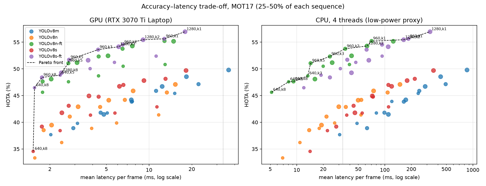

# Where Should a Real-Time Tracker Spend Its Compute?

A budget-aware study of tracking-by-detection on MOT17, with a pre-registered held-out test.

This project began as my undergraduate thesis, a YOLOv8 + DeepSORT pedestrian tracker. Here I re-evaluate that pipeline against human annotations, rebuild it, and ask a systems question: **under a fixed per-frame compute budget, should computation go to a stronger detector, to detecting more often, or to deciding adaptively which frames to detect?** Every headline claim below was written into a protocol file before the held-out half of the data was evaluated, and that evaluation was run once.

<p align="center">
  <br>
  <em>Accuracy–latency trade-off over 75 configurations (validation segment). Left: laptop GPU. Right: CPU limited to 4 threads, a stand-in for a low-power device.</em>
</p>

## Findings (pre-registered test, last 50% of every MOT17 training sequence)

| # | Hypothesis | Outcome | Evidence |
|---|---|---|---|
| H1 | A self-implemented ByteTrack beats the thesis DeepSORT tracker with the same detector | **Supported** | HOTA 35.1 → 38.6, IDF1 38.0 → 44.6, ID switches 103 → 88; better on 7/7 sequences |
| H2 | A fine-tuned detector beats the best pretrained detector at no higher latency | **Partly supported** | +9.7 HOTA in aggregate on CPU, but only 3–5/7 sequences improve; most of the gain comes from MOT17-04 |
| H3 | Under a CPU budget, a stronger detector every other frame beats a weaker one every frame | **Supported** | HOTA 47.4 vs 44.5 at 35.1 vs 39.1 ms/frame; 5/7 sequences |
| H4 | Adaptive detection scheduling does **not** beat a fixed interval at matched compute (expected null) | **Supported** | learned trigger −1.5 to −2.4 HOTA; segment allocation −1.1 to +0.1 |
| H5 | Fine-tuning on some scenes improves detection on unseen scenes | **Refuted** | −7.5 HOTA vs the pretrained detector on 3 held-out scenes (0/3) |

**End-to-end speed** (1920×1080, my thesis video): the original pipeline ran at **8.5 FPS**. The rebuilt pipeline runs at **44.3 FPS** on GPU including video writing (81.5 FPS without), and at **39.6 FPS** on a 4-thread CPU when it detects every third frame.

### What this means

1. **The thesis numbers were wrong, and the bottleneck was not the detector's speed.** The DeepSORT update, dominated by appearance-feature extraction (55 ms), and preprocessing (29 ms) took most of each frame; detection took 16 ms. The preprocessing also did not improve recall (+0.3 points), contrary to the thesis claim.
2. **Spend compute on detection quality, not detection frequency.** Across every budget, the accuracy–latency frontier is made of stronger detectors run less often.
3. **Uniform detection is near-optimal on MOT17.** Seven adaptive policies were tested:
   - per-frame triggers from Kalman-filter drift;
   - a self-supervised learned trigger;
   - budgeted 2-second segment allocation via Lagrangian relaxation.

   None beat a fixed interval at matched compute. Even per-frame triggering with hindsight knowledge of drift did not win. Segment allocation with hindsight has at most about 1.4 HOTA of headroom.
4. **The pre-registered test overturned one of my own validation-stage conclusions.** On validation, fine-tuning looked far more valuable than model size. The held-out test showed that small-data fine-tuning mostly learns the scenes it saw: on unseen scenes it hurts.

## Method

- **Detection:** YOLOv8 n/s/m at 640/960/1280 input, either COCO-pretrained or fine-tuned on MOT17 (first 25% of each sequence only). All detections and per-frame latencies are cached once.
- **Tracking:** a self-implemented Kalman filter (constant velocity in center/aspect/height space) with Hungarian matching. ByteTrack mode adds a second association round with low-score detections. On frames without detection, the tracker propagates tracks by Kalman prediction only. Tracker cost is about 0.4 ms per frame.
- **Budgets:** latency per frame = detector cost × detection rate + tracker cost. GPU cost is measured per frame; CPU cost is measured with 4 threads.
- **Scheduling policies:**
  - fixed interval;
  - geometric drift rule (Kalman speed × frames since detection, plus crowding and frame-difference triggers);
  - learned drift predictor (gradient boosting on self-supervised labels, leave-one-sequence-out);
  - segment allocation (multiple-choice knapsack via Lagrangian relaxation, with risk from frame-difference energy and Kalman speed);
  - hindsight references.

## Evaluation protocol

Each MOT17 training sequence (7 scenes) is split in time:

| Segment | Used for |
|---|---|
| first 25% | detector fine-tuning only |
| 25–50% | all comparisons, design choices and threshold grids |
| last 50% | **sealed**; evaluated once under [`results/test/PROTOCOL.json`](results/test/PROTOCOL.json) (hypotheses, configurations, hashes of models and splits) |

- **Metrics:** official TrackEval (HOTA, MOTA, IDF1; vendored in `third_party/`).
- **Comparisons:** at matched detection rate by linear interpolation, with per-sequence win counts.
- **Cross-scene check:** the detector is fine-tuned on 4 scenes (2 static-camera, 2 moving-camera) and tested on the other 3.

## Results files

| File | Contents |
|---|---|
| [`results/step3_report.txt`](results/step3_report.txt) | thesis baseline on MOT17 and a per-stage timing breakdown |
| [`results/step6_report.txt`](results/step6_report.txt) | all 75 accuracy–latency configurations |
| [`results/step7_report.txt`](results/step7_report.txt), [`results/step8_report.txt`](results/step8_report.txt) | adaptive scheduling (validation) |
| [`results/test/test_report.txt`](results/test/test_report.txt) | the pre-registered test (H1–H5) |
| [`results/step11_report.txt`](results/step11_report.txt) | end-to-end FPS |

## Reproducing

```bash
pip install torch torchvision --index-url https://download.pytorch.org/whl/cu126
pip install -r requirements.txt scikit-learn
# MOT17 from https://motchallenge.net/data/MOT17/ → data/MOT17/train/MOT17-02-FRCNN/...
python step1_prepare.py --mot17 data/MOT17          # temporal splits
python step2_detect.py  --mot17 data/MOT17 --models n s m --imgsz 640 960 1280
python step4_finetune.py --mot17 data/MOT17         # fine-tune n/s on the first 25%
python step2_detect.py  --mot17 data/MOT17 --models n-ft s-ft --imgsz 640 960 1280
python step5_cpu_latency.py --mot17 data/MOT17
python step3_baseline.py --mot17 data/MOT17        # thesis baseline
python step6_frontier.py                            # accuracy–latency frontier
python step7_schedule.py --mot17 data/MOT17         # per-frame scheduling
python step8_allocation.py --mot17 data/MOT17       # segment allocation
python step9_xscene.py  --mot17 data/MOT17          # cross-scene fine-tuning
python step10_test.py   --mot17 data/MOT17          # one-shot pre-registered test
```

Tested on Windows 11, Python 3.11, PyTorch 2.14 + CUDA 12.6, RTX 3070 Ti Laptop GPU, i7-12700H.

## Limitations

- One benchmark (MOT17, 7 scenes), pedestrians only. Per-sequence results vary widely, and aggregate scores are dominated by the densest sequence (MOT17-04).
- The CPU budget is a laptop CPU limited to 4 threads, not a measured embedded device. Energy was not measured.
- Fine-tuning used a small dataset (about 1,100 frames) with default hyper-parameters; better regularized or larger-scale adaptation may transfer better.
- The scheduling study uses one tracker family (Kalman + IoU association); appearance-based trackers may respond differently to sparse detection.

## References

- Zhang et al., *ByteTrack: Multi-Object Tracking by Associating Every Detection Box*, ECCV 2022.
- Wojke et al., *Simple Online and Realtime Tracking with a Deep Association Metric*, ICIP 2017.
- Luiten et al., *HOTA: A Higher Order Metric for Evaluating Multi-Object Tracking*, IJCV 2021.
- Milan et al., *MOT16: A Benchmark for Multi-Object Tracking*, arXiv 2016.
- Jocher et al., *Ultralytics YOLOv8*, 2023.
